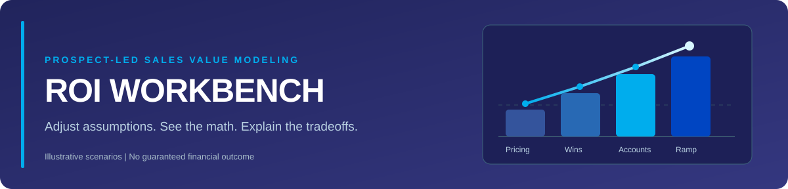

# Sandler ROI Workbench

**Live site:** [Open the Sandler ROI Workbench on GitHub Pages](https://mythologiq-labs-llc.github.io/sandler-roi/). GitHub Pages publishes the `main` branch; new work appears after a successful deployment.

**A customer-centered financial conversation, not a promise of ROI.** A Sandler representative can use this browser-based tool with a customer to review their own starting figures, explore hypothetical improvements, validate sources, and finally examine how the modeled value compares with the training investment. The workbench personalizes its headings using the customer's entered name.

**Status:** Public, illustrative prototype. The Pages URL serves the current `main` revision, not unmerged feature work. This is not an official Sandler publication, a brand-approved tool, or an independently validated financial forecast. The project-specific illustration is original to this repository, not Sandler corporate logo artwork.

## On this page

- [Quick start](#quick-start)
- [Use it in a customer conversation](#use-it-in-a-customer-conversation)
- [What it models](#what-it-models)
- [How calculations work](#how-calculations-work)
- [Validation and evidence](#validation-and-evidence)
- [Data handling](#data-handling)
- [Architecture and tests](#architecture-and-tests)
- [Current limits](#current-limits)

## Compact four-point workbench stage timeline

The horizontal **Discover → Model → Compare → Present** navigation is a thin 2px line with four small diamond markers rather than four large, numbered cards. The active point is Sandler energetic blue, earlier-position points are teal, and upcoming points are outlined. Stage labels remain below each point; the clickable area remains the full native button. Keyboard arrows, Home and End move focus and navigate stages. This is a position indicator only, not a claim that earlier stages were completed or verified.

The line and progress segment are CSS-generated, and the existing stage-state code remains the authority. The timeline remains visible on Present and is hidden in print. The top header is slightly slimmer. The customer data, financial calculations, staged reveal and JSON/CSV compatibility are unchanged.

## Project development effort

Approximate build and refinement effort is tracked in the [public project effort ledger](docs/engagement/effort-ledger.md), with an auditable entry for each work phase. Run `npm run effort` to see the current calculated total. The entries are provisional until reviewed; they are **not** an invoice or an assertion of approved billable hours. Hourly rates and commercial terms are deliberately excluded from this public repository.

## Quick start

**Hosted prototype:** [Open the Sandler ROI Workbench on GitHub Pages](https://mythologiq-labs-llc.github.io/sandler-roi/). No installation or sign-in is required. The initial customer example and financial figures are fictional; **do not enter confidential client information into a public demo** without confirming your organization's data-handling rules.

**Run locally:** Install **Node.js 20 or later** and Git. No `npm install`, cloud account, database, API key, or external runtime dependency is needed. Run:

\`\`\`bash
git clone https://github.com/MythologIQ-Labs-LLC/sandler-roi.git
cd sandler-roi
npm start
\`\`\`

**Expected first result:** The local server prints `Sandler ROI Workbench: http://127.0.0.1:4173`. Open [http://127.0.0.1:4173](http://127.0.0.1:4173). Discover starts with **Sample customer**, a $79,200 illustrative investment and current baseline metrics. Rename the customer to see headings update immediately. Conservative/Expected/Upside results appear only in **Present**, after baseline modeling and review.

The preview server binds to \`127.0.0.1\`. Opening \`index.html\` directly using \`file://\` is not supported because the browser restricts JavaScript modules loaded from local files. The first-use path is **source-inspected** and its user interactions were simulated offline. An actual Chromium/Edge browser acceptance run is still pending.

## Saved customer work and development feedback

The **Work & reports** menu separates three tasks:

- **Saved customer work:** **Customer files** lets the representative choose an existing local folder, save the current customer model, and reopen a selected customer from a list. Browser folder access requires user permission and works in supported secure-context browsers (typically current Chrome/Edge); the app never silently scans the disk or saves changes in the background. Reconnect to the folder when returning in a new browser session. Files use the existing versioned JSON snapshot schema. Explicit overwrite/delete confirmations protect earlier work.
- **Backup and recovery:** **Download JSON backup** and **Open JSON backup** remain available when folder access is unsupported and when moving work between devices. These backups preserve the editable model; they are not a centralized CRM or encrypted customer vault.
- **Data exchange and reports:** CSV mapping, the blank CSV template, CSV export, and print stay separate from saved customer work.

**Privacy:** Client JSON files are plain text on the representative's own computer. Use organization-approved storage for confidential material. Files are not automatically saved, synchronized, uploaded, encrypted, or recoverable after accidental deletion. The public Pages prototype is not an approved secure customer record system.

A deliberate development link (**add `?devFeedback=1` to the workbench URL**) exposes **Feedback mode** without cluttering the default customer-facing interface. This URL switch is **not authentication**. The mode offers stage-aware written suggestions and optional microphone voice notes while the user continues navigating the application. Notes contain the current stage, optional Discover panel and selected Present scenario, but **not financial input values or customer names**. Recording starts only after an explicit microphone action and permission, and stops when the user chooses Stop or after two minutes. Notes remember the screen where the comment or recording began, even if the representative navigates before adding it; uncheck the context option for an overall note. Voice clips are capped at 15 MB each, 40 notes per package, and 50 MB for the entire package. An unfinished comment or voice note must be added or cleared before export. A single local ZIP package contains `feedback.json` and any voice clips for deliberate review and sharing. The app does not transmit feedback, run transcription, start screen recording, or generate issues automatically. Closing the tab before export can lose feedback.

The customer-file folder and feedback workflows are presentation/UI features and do not modify `src/roi.mjs` or existing financial formulas.

## Use it in a customer conversation

1. **Discover:** Establish the customer's current win rate, deal volume, average deal, sales ramp, investment and evidence. No ROI or scenario outputs are displayed here.
2. **Model:** Explore changes in selling behaviors. Adjust working assumptions and see operating measures evolve, not financial returns.
3. **Compare:** Validate current-versus-hypothetical operating measures, investment scope, source confidence, pain, budget and decision process.
4. **Present:** Reveal the current-to-possible operating difference and modeled incremental value, investment, net benefit and ROI. Only here do **Conservative**, **Expected** and **Upside** appear. Return to any earlier stage or use **Print**, local **JSON**, and **CSV** for follow-up.

Every starting value is **fictional demonstration data**, not a customer fact or a Sandler benchmark. An entered number is not automatically verified. The customer and representative should confirm definitions, units, periods, and financial sources before circulating a business case.

### Why financial outcomes appear at the end

Showing the full financial payoff during baseline discovery preempted the customer's own understanding of their current situation. The visual flow now starts with customer-entered facts, builds and reviews hypotheses, and only then reveals potential ROI. The proposed future win rate and seller ramp use explicit, transparent arithmetic; no invented zero-revenue baseline is used to exaggerate the difference. The calculations have not been changed.

This pacing draws on Sandler's public [selling system](https://sandler.com/sandler-selling-system/), which emphasizes pain, budget and decision process before presenting fulfillment. The four workbench stages are not a replacement for Sandler's seven-step selling methodology.

### Guided meeting workbench

The [guided workbench implementation](src/app.mjs) uses a **progressive disclosure journey**: **Discover** shows baselines; **Model** shows working behavioral hypotheses; **Compare** reviews operational changes and sources; and **Present** shows the full financial opportunity, scenario alternatives, value-driver detail and caveats. The navigation remains freely available. This is a guided conversation, not a forced close or a claim of causation. See the [design decision](docs/design/progressive-reveal.md).

The UI uses Sandler's published **Stable** (\`#21245c\`), **Fresh** (\`#00aded\`), and **Energetic** (\`#0045c2\`) palette. The header uses the authentic Sandler white wordmark with cyan UpStep from a Sandler-affiliated training-center CDN. Its source and the official [logo kit](https://sandler.com/wp-content/uploads/2023/03/Sandler-Logo-Kit-1.zip) are documented below. The logo is loaded from Sandler's affiliated domain, not copied into this repository, and that image request is the only external asset request introduced by this UI change. See [workbench user journey and branding decisions](docs/design/rep-workbench-journey.md).

## Discovery layout and CSV import

Discover is now organized as **four tabs within its sidebar** (Engagement, Performance, Pipeline, Evidence), rather than a single vertically stacked form. The sidebar has a bounded viewport on desktop; selecting a tab preserves the inputs and reduces whole-page scrolling. The **Discover → Model → Compare → Present** journey stays visible even on the Present step. Print still excludes the interactive navigation.

**Import options:**
- **Saved JSON model:** workbench's versioned \`sandler-roi/1\` and \`sandler-roi/2\` snapshots.
- **Customer CSV:** choose a row, review automatically suggested header mappings, adjust any mapping, and explicitly apply. A downloadable blank template defines canonical column names. Only mapped fields are imported, and *every unprovided financial value is missing*, not an illustrative default. The active scenarios reset to the sample assumptions to avoid borrowing a previous client's sensitivity choices.
- **Key/value CSV:** \`field,value\` (or a workbench-exported \`Metric,Value\` CSV with \`Input <field>\` rows) is recognized; the importer never trusts computed ROI cells or evidence flags from the exported report.

**CSV is not a universal Sandler standard or CRM connector.** Real CRM exports use different columns and time windows. The mapping table is the deliberate compatibility layer. Numeric fields use ROI engine validation, with \`40%\` interpreted as **40 percentage points** rather than 0.4. Maximum input size is 2 MB, 500 data rows, and 100 columns. Client records stay in-memory until the rep applies one row; any imported source labels begin **unconfirmed**, not verified.

**Brand source:** Official [Sandler branding page](https://sandler.com/branding/) and [logo kit](https://sandler.com/wp-content/uploads/2023/03/Sandler-Logo-Kit-1.zip). The on-screen wordmark currently comes unchanged from \`go.nextlevel.sandler.com\` (an affiliated Sandler training center). It requires an image request to that domain; \`referrerpolicy="no-referrer"\` prevents the containing page URL from being forwarded. The four navigation line icons are original artwork following Sandler's published circular white-line icon style. The approved official kit should replace the CDN dependency once its files are available locally.

### Customer-owned language and stable data formats

The workbench is designed to communicate **the customer's own business case**, not an internal prospect worksheet. Entering `John Doe` immediately changes the baseline heading to **John Doe’s starting point**, with customer-owned language throughout Model, Compare, Present, and printed summaries. Clearing the name restores **The customer’s starting point**. Individual card labels remain short for readability.

Names identify the subject of the entered numbers, **not** independent data verification or a completed purchase. Illustrative and unconfirmed source notices remain visible.

**Compatibility:** The internal JSON key `inputs.prospect` remains unchanged for saved model schemas `sandler-roi/1` and `sandler-roi/2`. New CSV templates and reports use `customer` / `Customer` / `Input customer`; the importer also supports legacy `Prospect` / `Input prospect` headers. No financial calculation changes. See the [copy audit](docs/design/customer-ownership-copy-audit.md).

## Independent financial math review

The [independent calculation audit](docs/verification/financial-math-audit-2026-11-24.md) checks all four modeled benefit drivers, investment modes, overlap deductions, net results, ROI, benefit/cost multiples, simple payback, price break-even and the separate pipeline sensitivity calculation. An independently authored reference model tests 400 deterministic input combinations in addition to explicit sample and boundary fixtures.

**Important:** This verifies the computation under the *stated* assumptions, not real customer outcomes or Sandler training attribution. The 12-month conservative example does not achieve payback during its evaluated term; the new Present presentation labels any extrapolated payback. Fee-only costs must never be described as fully loaded costs. Multi-year account and hiring assumptions need a separate business definition before a production financial claim.

## What it models

The current version includes four independently enabled financial drivers:

| Financial driver | Customer question it explores |
| --- | --- |
| **Price realization** | How much gross profit might be retained by discounting less? |
| **Win-rate improvement** | What is the value of winning more of the same proposal opportunities? |
| **Major accounts** | What might additional qualified national or multi-site accounts contribute? |
| **Faster onboarding** | How much extra productive selling time could shorter new-hire ramps unlock? |

A separate **optional pipeline bridge** accepts qualified pipeline, observation weeks, assumed conversion, gross margin, and a scenario attribution factor. It estimates potential closed revenue and gross profit, but **never adds that bridge to the four-driver ROI total** because the same deals may already be counted elsewhere. Missing pipeline figures do not invalidate the main ROI model.

Sandler's [Revelry GTM case study](https://sandler.com/case-study/revelry-gtm/) appears as **illustrative reference context only**, not a source of preset ROI effects. See the [case-study evidence mapping](docs/case-studies/revelry-gtm.md).

## How calculations work

The model estimates **incremental gross-profit contribution**, not total sales revenue or verified cash flow. All percentage inputs are shown as 0–100 in the interface and divided by 100 in calculations. **Percentage-point improvements are different from relative percent changes.**

The current engine scales annual baseline flows by \`programMonths / 12\` as a simplifying assumption. It does not model calendar-specific sales cycles, staggered hiring, delayed wins, or month-by-month benefit realization.

| Driver | Contribution formula for the evaluation period |
| --- | --- |
| Price realization | Discount-affected annual revenue × price improvement points / 100 × price profit-flow rate × realization rate × period years |
| Proposal wins | Annual proposals × win-rate improvement points / 100 × average deal revenue × gross margin × realization rate × period years |
| Major accounts | New accounts × annual revenue/account × first-year revenue capture × gross margin × realization rate × period years |
| Faster onboarding | New hires × saved ramp months / 12 × productive seller annual revenue × gross margin × realization rate × period years |

The model uses a configurable overlap deduction on **win-rate and major-account** contributions. This is a rough sensitivity control; it is **not** a complete attribution method. Price retention and onboarding can also overlap with other value sources.

- **Modeled benefit** = included contributions, less the implemented overlap deduction.
- **Program cost** = monthly fee × program months + one-time setup fee.
- **Net value** = modeled benefit − program cost.
- **ROI (%)** = net value ÷ program cost × 100, when cost is positive.
- **Benefit-to-cost multiple** = modeled benefit ÷ program cost, when cost is positive.
- **Simple payback** = program cost ÷ (modeled benefit ÷ program months), assuming even monthly benefit. This is **not** verified cash-flow payback.
- **Break-even additional price points** = remaining program cost after other modeled drivers ÷ eligible, contribution-adjusted discounted revenue × 100, where the pricing driver and denominator are valid.

Missing or invalid inputs for an **included** driver make total ROI **incomplete** rather than silently counting that benefit as zero. Disabling a driver is an explicit choice to exclude it.

For exact assumptions, known horizon/attribution limitations, and component contracts, see [Architecture and model contracts](docs/ARCHITECTURE.md).

## Validation and evidence

This prototype helps a representative **project** potential value. It does **not** certify achieved financial return or prove that Sandler caused a result. A client-reported baseline, validated financial extract, skill adoption score, and attributable profit gain represent different levels of evidence.

Our [research review of Sandler's public ROI and measurement practices](docs/research/sandler-roi-validation-2026.md) distinguishes Sandler's published **Sales Performance Ecosystem** from independent financial ROI verification. Sandler publicly describes Baseline → Improve → Reassess → Reinforce → Retain → Optimize, but we have **not** inspected an official Sandler ROI calculation specification or its third-party-operated calculator.

**Verification status:** Source code and tests are checked into this repository. Review exact-commit GitHub Actions results before any release claim. Real-browser usability, Sandler brand approval, and human financial review are **separate acceptance gates**.

## Data handling

- The current workbench calculates in the browser. The local preview server serves static files; no customer metrics are automatically posted to a remote service.
- No automatic data persistence, telemetry, third-party runtime libraries, or cloud account integration is included.
- Exported JSON and CSV files can contain sensitive commercial information. Store, share, and remove them according to the customer's data-handling requirements.
- JSON imports use recognized model fields; imported text is not evaluated as executable formulas.
- Input limits reject negative values, invalid percentages, impossible win rates and impossible ramp reductions.
- Training outcomes depend on the customer, market conditions, implementation, and adoption. Scenario outputs are **not guarantees, audited financial statements, or evidence of causation**.

The link to Sandler's public case study opens an external website only if selected. The application does not integrate with Sandler's Sales Performance Ecosystem or its referenced external ROI calculator.

## Architecture and tests

| Path | Purpose |
| --- | --- |
| [\`src/roi.mjs\`](src/roi.mjs) | Deterministic calculations, numeric input validation, and pipeline bridge |
| [\`src/app.mjs\`](src/app.mjs) | User inputs, scenarios, visualization, exports, and presentation controls |
| [\`index.html\`](index.html) | Browser page and responsive/print layout |
| [\`server.mjs\`](server.mjs) | Restricted loopback static preview server |
| [\`tests/roi.test.mjs\`](tests/roi.test.mjs) | Financial formula and boundary-case regression tests |
| [\`AGENTS.md\`](AGENTS.md) | Repository-local contributor instructions, not an approved corporate policy |
| [Architecture and model contracts](docs/ARCHITECTURE.md) | Units, formula boundaries, risks and future design decisions |
| [Sandler measurement research](docs/research/sandler-roi-validation-2026.md) | Corporate/vendor claims versus recommended verification controls |

From the feature-branch checkout, run:

\`\`\`bash
npm test
\`\`\`

This invokes the repository's Node.js test suite. It does not run a browser usability test or independently certify the financial assumptions. The repository uses no package dependencies in its current \`package.json\`.

## Current limits

- Four financial driver formulas are implemented; **user-authored drivers and a general KPI formula registry are not**.
- Price effects assume no lost deal volume unless adjusted by user-defined realization assumptions.
- First-year national-account capture, annual hiring counts, multi-year periods and cross-driver attribution require more modeling.
- Paid training time, travel, software, and indirect implementation costs are **not** included in the current program-cost formula.
- Simple payback assumes a uniform benefit run rate; a measured monthly cash-flow ledger does not exist.
- Verified realized ROI, CRM/SPE integration, authenticated user accounts, formal data provenance and production deployment are outside this version.

**Licensing:** No standalone software license was found in the inspected repository root; do not assume public redistribution or reuse rights. Sandler and associated names are used to describe the intended sales workflow, not to claim official ownership or sponsorship. See [Sandler](https://sandler.com/) for its published training materials.

## Investment and evidence hardening

The [cost and evidence implementation](src/evidence.mjs) introduces **fee-only versus expanded cost estimates** and **per-input source declarations**. Expanded cost inputs account for paid training time, monthly support, travel, technology, administration and other relevant expenses. Expanded inputs must be explicitly entered, including zero when appropriate. Source classifications remain self-declared and cannot certify realized ROI.

**GitHub Pages delivery:** The site is published from `main` at https://mythologiq-labs-llc.github.io/sandler-roi/ through GitHub Pages. The PR validation workflow runs `npm test`, a static Pages preflight, and a loopback server smoke test. A successful Pages deployment confirms the publication, not Sandler branding approval, client-data security certification, or financial correctness.
